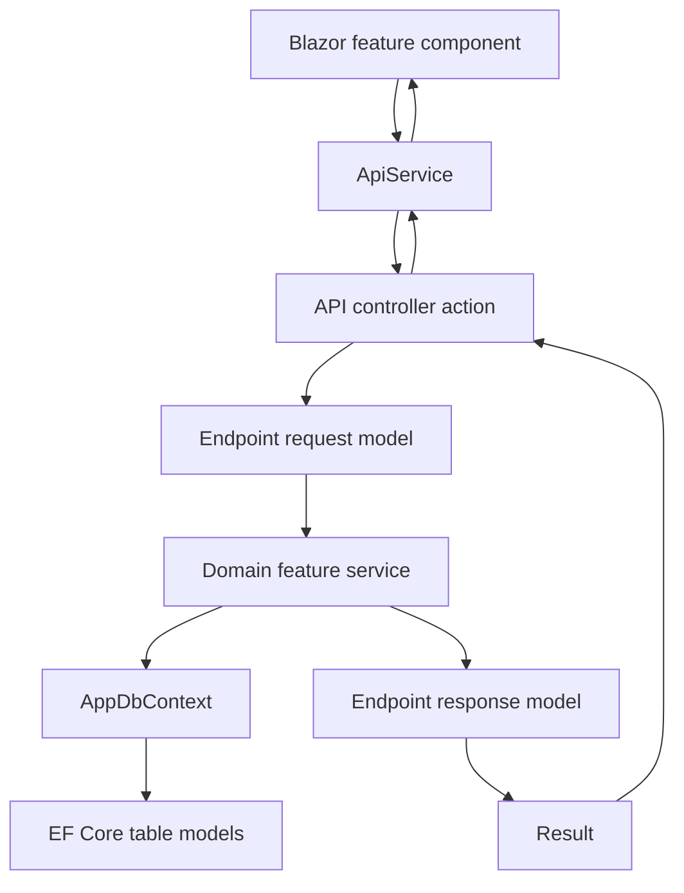
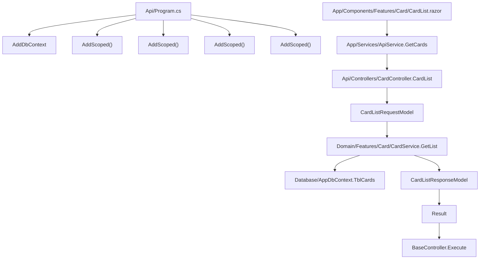
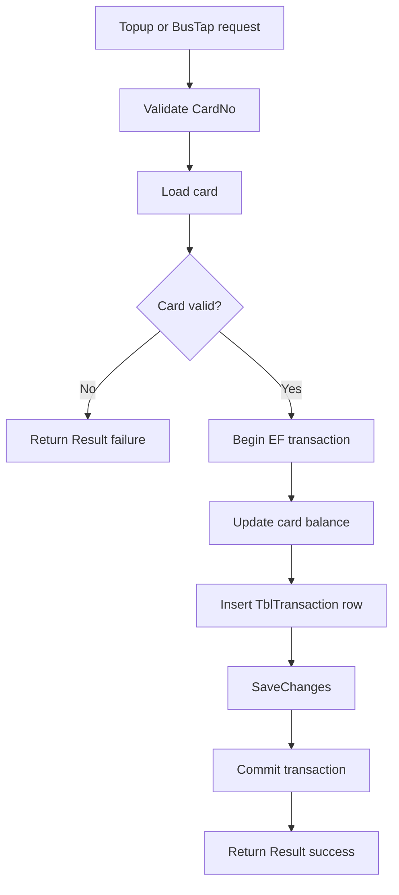

# Feature-Oriented Architecture

Use this reference for Collin-style feature-oriented .NET solutions, especially projects like `D:\slh\proj\YbsSmartCardSystem`.

## Project Shape

- `*.Api`: ASP.NET Core controllers, DI registration, Swagger, database context setup.
- `*.Domain`: feature folders with services and endpoint-specific request/response models.
- `*.Database`: EF Core database-first `AppDbContext` and table models.
- `*.App`: Blazor UI with feature components and an API client service.

Example feature folders:

- API: `YbsSmartCardSystem.Api/Controllers/CardController.cs`
- Domain: `YbsSmartCardSystem.Domain/Features/Card/CardService.cs`
- Models: `YbsSmartCardSystem.Domain/Features/Card/Models/CardListModel.cs`
- UI: `YbsSmartCardSystem.App/Components/Features/Card/CardList.razor`

## Core Rules

- Keep controllers thin: bind request models, call one feature service, return `Result<T>`.
- Keep business logic in `*.Domain/Features/<Feature>/<Feature>Service.cs`.
- Keep request and response models beside the feature, not in a global shared DTO folder.
- Give each endpoint its own request model and response model.
- Do not return EF Core entities directly from API endpoints.
- Listing endpoints and pages must paginate and order descending by default.
- Use `AsNoTracking()` for read-only EF queries.
- For balance or money changes, use a database transaction and write a transaction log row.

## Step-by-Step API Flow

1. Register EF Core and feature services in `Api/Program.cs`.
2. Controller action binds route/query/body into the endpoint request model.
3. Controller calls the matching domain feature service method.
4. Service validates input and loads only needed EF data.
5. Service applies business rules.
6. Service maps EF entities to endpoint response models.
7. Service returns `Result<TResponse>`.
8. Controller returns success or error using `BaseController.Execute`.

## Step-by-Step UI Flow

1. Blazor feature page lives under `App/Components/Features/<Feature>`.
2. Page owns screen state, request model, result model, busy flag, and messages.
3. Page calls `ApiService`.
4. `ApiService` builds the HTTP route and query string.
5. API returns `Result<TResponse>`.
6. Page renders success/error message and response data.

## Add a New Feature

1. Create `Domain/Features/<Feature>/<Feature>Service.cs`.
2. Create `Domain/Features/<Feature>/Models/<Feature>Models.cs`.
3. Add endpoint-specific request/response models for each action.
4. Add `Api/Controllers/<Feature>Controller.cs`.
5. Register `<Feature>Service` in `Api/Program.cs`.
6. Add API client methods in `App/Services/ApiService.cs` if the Blazor app needs the feature.
7. Add UI under `App/Components/Features/<Feature>/`.
8. Add navigation only after the page exists and works.
9. Build and run the narrowest check, usually `dotnet build`.

## Feature Flow Diagram

## Code Flow Diagram

## Money Flow Example

## Naming Pattern

- Controller: `<Feature>Controller`
- Service: `<Feature>Service`
- Request model: `<Feature><Action>RequestModel`
- Response model: `<Feature><Action>ResponseModel`
- List item model: `<Feature>ListItemResponseModel`
- Endpoint route: `api/<Feature>`

## Pitfalls

- Do not create generic DTOs just to reuse two fields.
- Do not put feature business logic in controllers or Razor components.
- Do not expose `Tbl*` EF entities through API responses.
- Do not skip pagination for list APIs or list pages.
- Do not update balances without a transaction log row.
