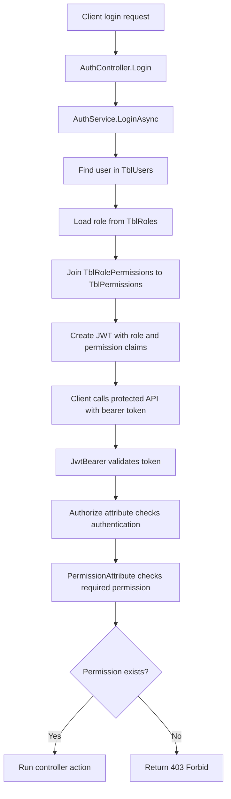
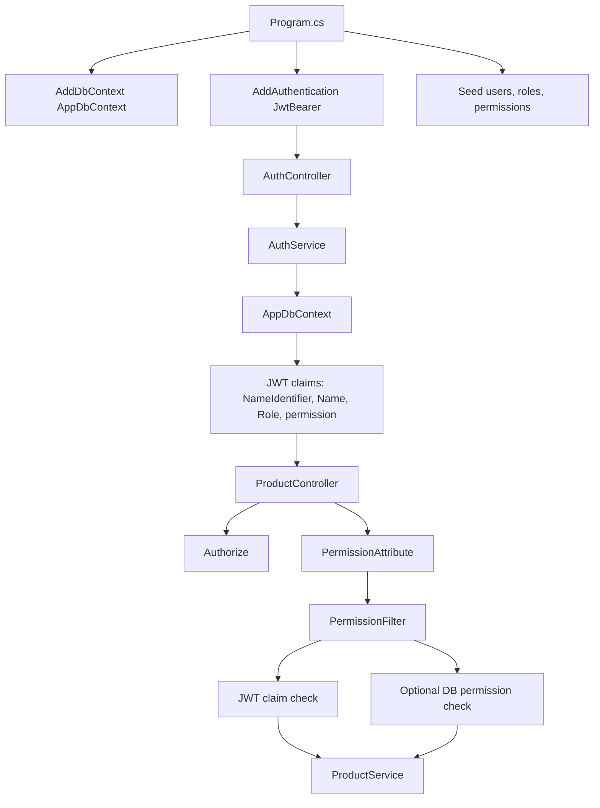

# JWT Dynamic RBAC

Use this reference for ASP.NET Core JWT authentication with dynamic role-based access control, especially projects like `D:\slh\proj\DotNetTrainingBatch0.JwtDynamicRbacWebApi`.

## Project Shape

- `DotNetTrainingBatch0.JwtDynamicRbacWebApi`: ASP.NET Core Web API, controllers, services, filters, JWT setup.
- `DotNetTrainingBatch0.Database`: EF Core `AppDbContext` and database models.
- Tables/models: `TblUsers`, `TblRoles`, `TblPermissions`, `TblRolePermissions`.
- Default training provider: EF Core InMemory. Use MSSQL for real persistence.

## Step-by-Step Flow

1. Register services in `Program.cs`: controllers, Swagger bearer support, `AuthService`, `ProductService`, `AppDbContext`, JWT bearer authentication.
2. Seed roles, permissions, role-permission mappings, and demo users after `app.Build()`.
3. Client posts username/password to `POST /api/auth/login`.
4. `AuthController.Login` calls `AuthService.LoginAsync`.
5. `AuthService` finds the user from `TblUsers`, loads role from `TblRoles`, and joins `TblRolePermissions` to `TblPermissions` for the user's role.
6. `AuthService` creates JWT claims: user id, username, role, and one `permission` claim per permission.
7. Client sends the token as `Authorization: Bearer <token>`.
8. `UseAuthentication()` validates the token before `UseAuthorization()`.
9. `[Authorize]` requires an authenticated user.
10. `[Permission("Product.View")]` runs `PermissionFilter`.
11. Default permission mode checks the JWT `permission` claims. `checkFromDb: true` reloads the current user's role permissions from the database.
12. If permission is missing, return `ForbidResult`; otherwise the controller action and service run.

## Workflow Diagram

## Code Flow Diagram

## Add a New Protected Endpoint

1. Add or confirm the permission name in `TblPermissions`, for example `Order.Create`.
2. Map the permission to a role in `TblRolePermissions`.
3. Add `[Authorize]` to the controller or action.
4. Add `[Permission("Order.Create")]` to the action.
5. If using claim-based permission checks, log in again so the JWT contains the new permission claim.
6. If permission changes must apply immediately without a new login, use `[Permission("Order.Create", checkFromDb: true)]`.

## Production Notes

- Do not keep plaintext passwords, hardcoded JWT keys, or real connection strings in committed config.
- Hash passwords, move JWT secrets to secret-safe config, and use MSSQL for persistent RBAC data.
- Add validation, logging, `CancellationToken`, and async EF calls in production endpoints.
- Keep permission names stable and action-oriented, such as `Product.View`, `Product.Create`, `Product.Update`, `Product.Delete`.
