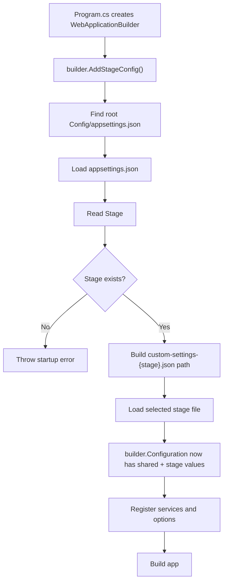
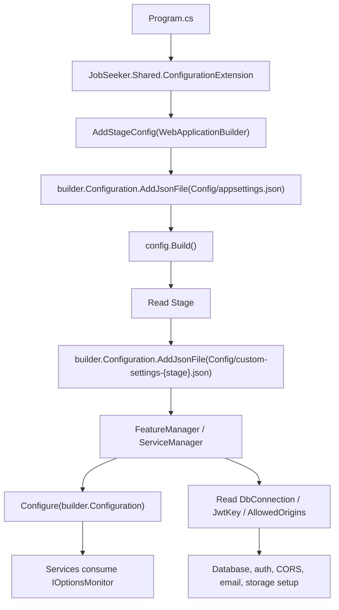

# Stage Config Pattern

Use this reference for Collin-style shared stage configuration, especially projects like `D:\slh\proj\job-seeker-admin-and-backend`.

## Project Shape

- Root `Config/appsettings.json`: stable defaults plus `Stage`, for example `dev`, `prod`, or `test`.
- Root `Config/custom-settings-{stage}.json`: stage-specific values such as connection strings, URLs, JWT settings, email settings, upload folders, payment gateway settings, and Firebase config path.
- Shared extension: `JobSeeker.Shared/ConfigurationExtension.cs`.
- App startup calls: `JobSeeker.Api/Program.cs`, `JobSeeker.Admin/Program.cs`, `JobSeeker.MockupServer/Program.cs`.
- Options model: `JobSeeker.Shared/Models/Setting/CustomSettingModel.cs`.

Do not copy real secrets from reference projects into new code or docs. Use placeholders or ignored local overrides.

## Step-by-Step Flow

1. App starts in `Program.cs` and creates the builder with `WebApplication.CreateBuilder(args)`.
2. Startup calls `builder.AddStageConfig()` before reading config-backed values.
3. `AddStageConfig` resolves the app content root.
4. It loads root `Config/appsettings.json`.
5. It builds a temporary configuration and reads `Stage`.
6. It fails fast if `Stage` is missing or empty.
7. It resolves root `Config/custom-settings-{stage}.json`.
8. It loads the selected custom settings file into `builder.Configuration`.
9. App startup and feature modules read values through `builder.Configuration`.
10. Modules bind settings with `builder.Services.Configure<CustomSettingModel>(builder.Configuration)` when typed settings are needed.
11. Runtime services consume config through `IConfiguration` or `IOptionsMonitor<CustomSettingModel>`.

## Startup Order

```csharp
var builder = WebApplication.CreateBuilder(args);

builder.AddStageConfig();

builder.Services.Configure<CustomSettingModel>(builder.Configuration);
// Register services that read DbConnection, JwtKey, AllowedOrigins, RootFolder, etc.

var app = builder.Build();
```

## Config Loading Diagram



## Code Flow Diagram



## Add Stage Config to a New App

1. Reference the shared project that contains `ConfigurationExtension`.
2. Add `using JobSeeker.Shared;`.
3. Call `builder.AddStageConfig()` immediately after builder creation.
4. Register services only after stage config is loaded.
5. Bind typed settings if needed: `builder.Services.Configure<CustomSettingModel>(builder.Configuration)`.
6. Keep root `Config/appsettings.json` and `Config/custom-settings-{stage}.json` beside the solution/root apps can find.
7. Add a startup check or narrow build/run check after changes.

## Testing Pattern

- Unit tests can bypass file loading with `ConfigurationBuilder().AddInMemoryCollection(...)`.
- Use `Stage = test` and test-safe placeholder values.
- For services expecting `IOptionsMonitor<CustomSettingModel>`, use a small test stub or options wrapper instead of reading real stage files.

## Pitfalls

- Do not call `builder.Configuration["JwtKey"]`, `AllowedOrigins`, or `DbConnection` before `AddStageConfig`.
- Do not commit real secrets in `custom-settings-dev.json` or `custom-settings-prod.json`.
- Do not hardcode one relative path if apps may move; prefer searching parent folders for `Config`.
- Do not duplicate shared values in each app's own `appsettings*.json`.
