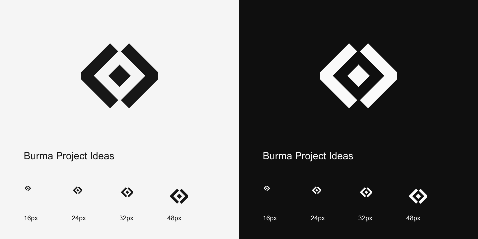

# Open data mark

The logo joins two open code brackets around a data diamond. It represents structured Myanmar data made available to builders. The solid geometry remains legible at favicon size and uses the existing ObsidianUI monochrome palette.



## Source and exports

`public/assets/brand-mark.svg` is the transparent vector master. Edit its `brand-geometry` path, then run:

```sh
npm ci
npm run brand:generate
npm run brand:check
```

The generator updates the header symbol and legacy landing sprite, and creates:

- Transparent 1024px PNG master and white-on-transparent SVG/PNG variant.
- Adaptive SVG favicon; PNG sizes 16, 32, 48, 64, 128, and 256px; ICO with 16/32/48px entries.
- Apple touch icon at 180px; standard and maskable app icons at 192/512px.
- Social-sharing SVG and PNG at 1200×630px; this light-on-dark composition matches the app theme.
- The light/dark review sheet above, including 16/24/32/48px marks.

Use dark ink `#171717` on light surfaces and `#fafafa` on dark surfaces. The standalone master has no background. App icons use a solid background and keep the mark inside the central maskable safe circle. Header SVGs inherit the current theme color and have no separate accessible name because the adjacent product name labels the link.

The social card uses installed Arial and Myanmar Text (or Noto Sans Myanmar) fonts. Font availability can affect text rendering when regenerating on another OS. No font files are distributed. Keep the generated PNG committed so deployed output remains stable.

There is no separate loading-screen logo in this application. Swagger and Scalar use the same adaptive favicon. The unused earlier logo concept was removed after checking tracked references. Existing third-party attribution remains in `public/THIRD_PARTY_NOTICES.md`.
